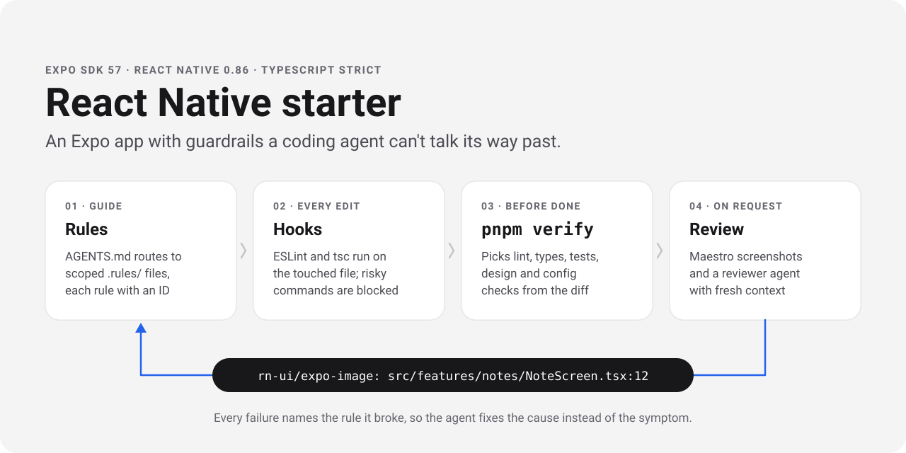

# React Native starter



[](https://github.com/wllnu/react-native-starter/actions/workflows/verify.yml)


[](LICENSE)

## What to look at

**The guardrail loop.** [`AGENTS.md`](AGENTS.md) is short on purpose. It routes the agent to the rule files in [`.rules/`](.rules) that match its change. Anything a tool can check lives in [`eslint.config.js`](eslint.config.js) or [`src/config.test.ts`](src/config.test.ts) instead, with a rule ID at the start of every message. The rule files keep only what needs judgment, with good and bad examples for each rule.

**Hooks the agent can't skip.** [`scripts/guard/`](scripts/guard) runs ESLint and `tsc` after every edit, blocks `--no-verify`, force pushes, deleted tests and reads of `.env` files, and runs the verify gate before the agent may end its turn. The same scripts plug into Claude Code, OpenCode and Pi through small adapters.

**One verify command.** [`scripts/verify.mjs`](scripts/verify.mjs) reads the diff and picks the tiers it needs: lint, types, related tests, the design token check, dependency alignment, config, a native-folder check and a secret scan. CI runs every tier on every file. [`design/check.mjs`](design/check.mjs) checks changed lines against the tokens in [`DESIGN.md`](DESIGN.md).

**Checks that need eyes.** [`scripts/verify-visual.mjs`](scripts/verify-visual.mjs) boots a simulator, runs the [Maestro flows](.maestro) and tails the logs for red boxes and nested-list warnings. [`.agents/rn-reviewer.md`](.agents/rn-reviewer.md) is a reviewer that sees only the diff and the rules, so it isn't defending its own code.

**The app itself.** Expo Router with typed routes, SQLite through Drizzle, MMKV for small settings and the React Compiler. The notes feature in [`src/features/notes`](src/features/notes) is the reference layout, so copy it when you add a feature: a public `index.ts`, data hooks over live queries, a Zustand store for client state only, Zod at the boundaries and tests next to the code. Each migration is tested against a database built from the previous release's saved schema. Sentry, Aptabase and a RevenueCat paywall are wired in and stay off until you add a key.

## Run it

The app needs a development build, because MMKV and the keyboard controller don't run in Expo Go.

```bash
pnpm install
pnpm ios        # or pnpm android
```

These set `APP_VARIANT=development`, so the build installs as `<bundleId>.dev` next to the preview and production builds.

Check a change with `pnpm verify`. It picks lint, types, tests and the design, dependency and config checks from your diff. `pnpm verify --full` runs everything, as CI does. Add packages with `npx expo install <package>`, which picks versions that match the SDK.

## After cloning

1. Fill in the `app` block at the top of `app.config.ts`: name, slug, scheme and bundle id prefix.
2. Run `npx eas-cli@latest init` and put the project id it prints into `easProjectId`.
3. Change `name` in `package.json` and the copyright line in `LICENSE`.
4. Replace the placeholder icons in `assets/images` and rewrite `DESIGN.md` for your product, then run `node design/check.mjs build`.
5. Want the app inside a pnpm monorepo, next to a Cloudflare Worker for example? Clone the starter into the monorepo's `apps/` folder and run `pnpm monorepo` from the clone. It drops the clone's own git history and lockfile, merges its pnpm settings into the root `pnpm-workspace.yaml` (your values win), moves the CI workflow to `.github/workflows/<folder>.yml`, wires the agent hooks and a pre-commit hook at the root, and stages the result for you to review. An empty monorepo (`git init` plus an `apps/` folder) works too.

## Optional services

Each service stays off until its key is set. A fresh clone runs with no accounts. Set the keys as EAS environment variables, or in `.env.local` for local builds.

| Service | Variables |
|---|---|
| Sentry crash reports | `EXPO_PUBLIC_SENTRY_DSN`. For source map upload on EAS also `SENTRY_ORG`, `SENTRY_PROJECT` and `SENTRY_AUTH_TOKEN`. |
| Aptabase usage events | `EXPO_PUBLIC_APTABASE_KEY` |
| RevenueCat subscriptions (iOS) | `EXPO_PUBLIC_REVENUECAT_IOS_KEY`. Without it the paywall and the Pro row in Settings are hidden. |

Users can turn Sentry and Aptabase off together with the switch in Settings.

## Keeping the guardrails

Every correction becomes a check. When you correct the agent, ask whether a linter or test could have caught the mistake. If one could, add a lint rule to `eslint.config.js` whose message starts with a rule ID, or an assertion to `src/config.test.ts`. If not, add a rule with an ID to the matching file in `.rules/`. `AGENTS.md` tells the agent to offer this whenever you correct it.

When you upgrade Expo or `eslint-config-expo`, look for new lint rules that cover a rule in `.rules/`. Move each one you find to `eslint.config.js` and delete the prose, so the same rule isn't judged twice.

## Database changes

Edit `src/shared/db/schema.ts`, run `pnpm db:generate`, and extend `src/shared/db/migrations.test.ts`. When a release ships, save its schema as a new fixture so the next migration is tested against real data from that release.
